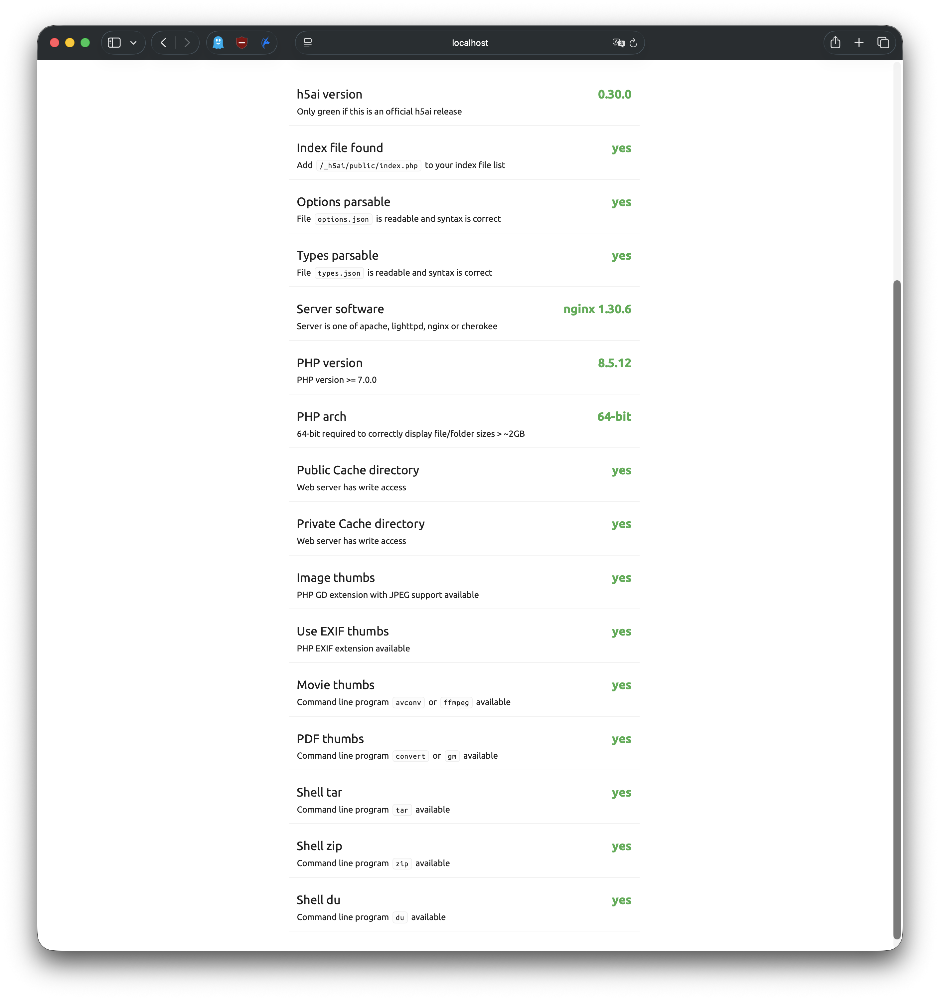
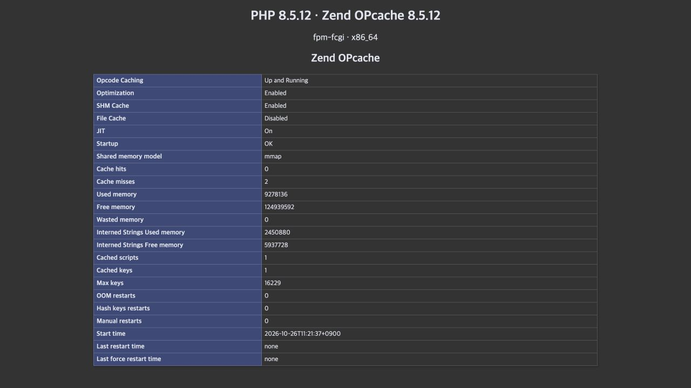
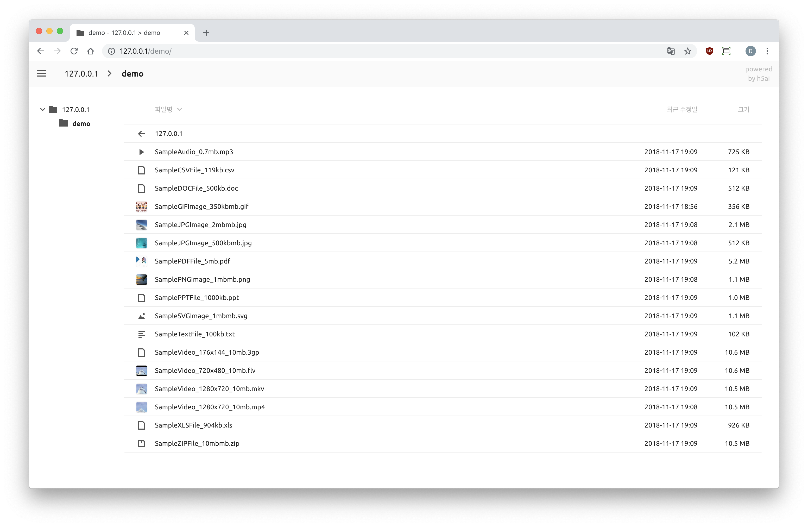

# docker-h5ai

%2C%20arm64%2C%20armv7%2C%20armv6-lightgrey?style=flat-square)


## What is h5ai

I'd like to quote the [official website](https://larsjung.de/h5ai/).
> h5ai is a modern file indexer for HTTP web servers with focus on your files. Directories are displayed in a appealing way and browsing them is enhanced by different views, a breadcrumb and a tree overview. Initially h5ai was an acronym for HTML5 Apache Index but now it supports other web servers too.

## What this project provided for

I hope this project would be useful for those who uses Docker for building their server.

## Features

### Core packages

I choose Alpine Linux as a base image to make it a **light-weight** service.
And I do choose Nginx-Alpine to get the benefits from some tweaks of Nginx version.

So this is composed of,

* Alpine Linux 3.24
* Nginx 1.30.6
* PHP 8.5.12 or newer

with,

* h5ai 0.30.0

And to gather all of these into one together I use supervisor that manages all of these processes.

PHP 8.5.12 or newer is required because it includes the fixes from the [October 21, 2026 PHP security release](https://www.php.net/archive/2026.php#2026-10-21-5).

### All functions work


h5ai supports extensional functions such as showing thumbnails of images and videos, caching for better speed, packaged downloads, etc. This image activates all of those functions.

### PHP 8 JIT enabled


JIT compiler that is introduced in PHP 8 is enabled by default. It uses the tracing mode with a 100 MB buffer, on top of the OPcache that is built into PHP 8.5.

### Supports multiple architectures

It builds from Github Actions for supporting multiple architectures such as AMD64(x86_64) and ARM64, ARMv7, ARMv6.

So that you can use this on most computers supporting Docker.

Before publishing, every architecture runs a container smoke test that checks file serving, thumbnails, downloads, authentication and configuration reuse. See [tests/README.md](tests/README.md) for what it covers and how to run it locally.

## How can I use this

First of all, it assumes that you have installed Docker on your system.

### Pulling the Docker image

Pull the image from docker hub with the following command.

```bash
docker pull awesometic/h5ai
```

### Basic usage

This is how it can be a service, in the other word, a container.

You can run it using the following command.

```bash
docker run -it --rm \
-p 80:80 \
-v /shared/dir:/h5ai \
-v /config/dir:/config \
-e PUID=$UID \
-e PGID=$GID \
-e TZ=Asia/Seoul \
awesometic/h5ai
```

The `--rm` option in the command is added to remove the executed container since this is an example usage.

Basically, two directories should be mapped to the host PC.

* `/h5ai`: This will be where the shared files located.
* `/config`: This will be where stores configurations of h5ai and Nginx settings.

And you should set proper **PUID** and **PGID**. If those not set up, the default UID, GID, the number 911, will be used for the `/config` directory. Not setting PUID/PGID will not significantly affect its operations, but setting up the proper number is still recommended.

Or you can handle some directories that has special permissions using these PUID/PGID.

If you want to run this image as a daemon, use `-d` option. See the following command.

```bash
docker run -d --name=h5ai \
-p 80:80 \
-v /shared/dir:/h5ai \
-v /config/dir:/config \
-e PUID=$UID \
-e PGID=$GID \
-e TZ=Asia/Seoul \
awesometic/h5ai
```

If you want to run this image permanently, so to speak, to keep it runs after rebooting the server, you can use `--restart unless-stopped` option. See the following command.

```bash
docker run -d --name=h5ai \
-p 80:80 \
-v /shared/dir:/h5ai \
-v /config/dir:/config \
-e PUID=$UID \
-e PGID=$GID \
-e TZ=Asia/Seoul \
--restart unless-stopped \
awesometic/h5ai
```

### Keep in safe from anonymous

If you want to login when visiting the hosted h5ai website so that implement protection from accessing anonymous users, add `HTPASSWD` environments like the below.

```bash
docker run -it --name=h5ai \
-p 80:80 \
-v /shared/dir:/h5ai \
-v /config/dir:/config \
-e PUID=$UID \
-e PGID=$GID \
-e TZ=Asia/Seoul \
-e HTPASSWD=true \
-e HTPASSWD_USER=awesometic \
awesometic/h5ai
```

Then only the user set by `HTPASSWD_USER`, **awesometic** can access this h5ai website with these options.

Be aware of that the `HTPASSWD` environment variable must be **true** for authentication.

And aware of this too that you have to run in interaction mode by adding **-it** to set a password for the newly created user for the first time.

Or, you can set the password for Htpasswd by passing an environment variable. In this case, you shouldn't have to use **-it** option because it is not needed at all.

### Use it as a real-time service

Consequently, if you want to run this image as a real-time service, check the following command.

```bash
docker run -d --name=h5ai \
-p 80:80 \
-v /shared/dir:/h5ai \
-v /config/dir:/config \
-e PUID=$UID \
-e PGID=$GID \
-e TZ=Asia/Seoul \
-e HTPASSWD=true \
-e HTPASSWD_USER=awesometic \
-e HTPASSWD_PW=awesometic \
--restart unless-stopped \
awesometic/h5ai
```

### Visit your website

To do the test drive, when the container runs then just let your browser browses:

``` http
http://localhost/
```


After all, you can see the directories you shared.

### Logs

You can check Nginx requests and PHP errors with `docker logs h5ai`.
To keep the log files on your host when you recreate the container, add a `/logs` mount:

```bash
docker run -d --name=h5ai \
-p 80:80 \
-v /shared/dir:/h5ai \
-v /config/dir:/config \
-v /log/dir:/logs \
-e PUID=$UID \
-e PGID=$GID \
-e TZ=Asia/Seoul \
-e LOG_ROTATE_INTERVAL_DAYS=1 \
-e LOG_RETENTION_DAYS=30 \
awesometic/h5ai
```

The log mount and the `LOG_*` variables are optional, so your existing Docker commands keep working.
Without the mount, log files stay inside the container and are lost when you remove it.

You can find the files in these directories:

* `/logs/nginx/access.log`: Requests to your website.
* `/logs/nginx/error.log`: Nginx errors and service messages.
* `/logs/php/error.log`: PHP errors and PHP-FPM service messages.

By default, logs rotate every day in the timezone set by `TZ`, and archives are kept for 30 days.
The first rotation is due after the next local midnight.
The container checks for rotation and expired archives every minute, even when nobody visits your website.
Older archives are compressed after the following rotation.

You can adjust this with environment variables:

* `LOG_ROTATE_INTERVAL_DAYS`: Days between rotations. The default is `1`.
* `LOG_RETENTION_DAYS`: Days to keep an archive after rotation. The default is `30`, measured in periods of 24 hours.
* `LOG_READ_GID`: The numeric host group allowed to read logs. The default is your `PGID`.

Both day values must be whole numbers between 1 and 36500, and retention must be at least the rotation interval.
Keep `/logs/.state` with the log files so the rotation schedule survives container recreation too.

Files belong to root, and the reader group can read them without changing or removing them.
Directories use `0750` permissions and files use `0640`; host root can still manage them.
Add your host user to the reader group if needed.
Mount `/logs` read/write so the container can record and rotate logs.
Use a dedicated directory for each container and let the container handle rotation instead of running a second host rotation job on those files.

Docker's logging driver controls its own retention separately.
Restarting the container or its log forwarding can replay current records in `docker logs`; the files under `/logs` are the retained copies.
There is no hard size limit on an active file, so allow enough disk space for your traffic.
Custom Nginx logging settings are preserved, but destinations outside stdout/stderr are not included in these managed logs.

## Caution when update

**If the new h5ai version releases**, I overwrite all the updated files to the corresponded directories on the project folder. In this sequence, some customized files by you will be replaced into the new one.

So it is **highly recommended to make back up files of your edits** before update the Docker image.

To prevent an unexpected accident, I put minimal protection into my `init.sh` script. This checks if the current `private/conf/options.json` file is outdated from the current about to be run. If the current `options.json` is older than the newly loaded one, the script makes its backup file under the `/config` directory. See the followings.

```bash
awesometic@awesometic-nas:docker/h5ai $ ll
total 32K
-rwxr-xr-x 1 root root  12K Jul 10  2019 20190710_165345_options.json.bak
-rwxr-xr-x 1 root root  12K Feb  3 14:46 20210203_144624_options.json.bak
drwxr-xr-x 3 root root 4.0K Feb  3 14:46 h5ai
drwxr-xr-x 2 root root 4.0K Dec 14  2018 nginx
```

But since I don't know how much the users edit their h5ai files like layout or style, it won't make backups for all of the h5ai related files. So it depends on your caution.

If you have any good idea, please let me know. 😀

**When updating from the PHP 8.2 image**, the PHP configuration directory has moved from `/etc/php82` to `/etc/php85`. If you mounted your own PHP settings, update their paths.

## Use with HTTPS (SSL)

It is highly recommended to use this web service with HTTPS for data encryption. Without SSL, the attackers can see your data streams even if you set the htpasswd to authenticate to the web page.

In this image, it is not provide any HTTPS related settings but you can set HTTPS with another web server. The most frequently used thing for HTTPS is a reverse proxy server, which can be set easiliy with a docker image called [SWAG from LinuxServer.io](https://hub.docker.com/r/linuxserver/swag).

## TODOs

* [x] Easy access to options.json
* [x] Access permission using htpasswd
* [x] Setup PUID/PGID to better handle the permissions
* [x] Expose Nginx, PHP log files to the host

## License

This project comes with MIT license. Please see the [license file](LICENSE).
